# Mentoria Radar — protótipo navegável

Proposta de redesign da plataforma **Mentoria Radar**, de preparação para concursos públicos. O protótipo mostra a experiência do **aluno** e do **mentor**. Ele é totalmente clicável e usa dados fictícios.

> Protótipo de apresentação. Não há backend: todas as ações (enviar lembrete, pagar plano, gerar com IA) são simuladas no navegador. Os nomes de alunos e todos os números exibidos são fictícios.

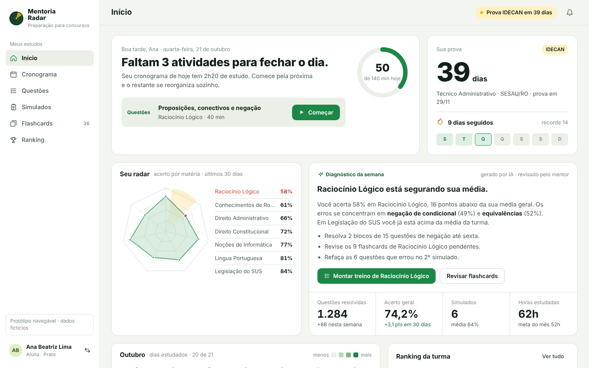

## Como abrir

O protótipo é um único arquivo, sem build e sem dependências.

- **Localmente:** baixe o repositório e abra `index.html` no navegador.
- **Pelo GitHub Pages:** em *Settings → Pages*, escolha a branch `main` e a pasta `/ (root)`. No plano gratuito do GitHub, isso exige que o repositório seja público.

Na tela de login, use **Entrar como aluno** ou **Entrar como mentor**. Para trocar de perfil a qualquer momento, clique no avatar no canto inferior esquerdo (ou no topo, no telemóvel).

## O que o protótipo demonstra

### Aluno

| Tela | O que mostra |
| --- | --- |
| **Início** | Missão do dia com progresso em minutos, contagem regressiva até a prova, sequência de estudo, **radar de acerto por matéria**, diagnóstico semanal por IA, calendário do mês e ranking da turma. |
| **Cronograma** | Semana do ciclo com meta por dia, atividades por tipo (teoria, questões, revisão, lei seca), dicas do mentor e **modo foco com cronômetro**. |
| **Questões** | Filtros por matéria, banca e situação. Permite eliminar alternativas, responder pelo teclado (A–E, Enter, X) e ver o percentual de cada alternativa, o gabarito comentado, a explicação da IA e os comentários. |
| **Simulados** | Simulado cronometrado com **cartão-resposta**, confirmação ao finalizar e resultado por matéria, com posição no ranking. |
| **Flashcards** | Baralhos com cartões pendentes, revisão espaçada (Errei / Difícil / Bom / Fácil) e criação de cartões **com IA a partir do edital**. |
| **Ranking** | Pódio e tabela da turma, ranking por simulado e progresso de nível na gamificação. |

### Mentor

| Tela | O que mostra |
| --- | --- |
| **Painel** | Alunos estudando agora, indicadores do período, questões por dia, horários de maior estudo, acerto por matéria e **alunos que precisam de atenção**, com o motivo de cada alerta. |
| **Alunos** | Busca, filtros por turma e situação, aderência ao cronograma e **ficha do aluno**, com o radar dele comparado ao da turma, o histórico e o envio de mensagem. |
| **Turmas** | Dias até a prova, aderência ao cronograma e acerto médio de cada turma. |

Há ainda uma **página de planos** (acessível pelo login), com os planos e as formas de pagamento.

## Decisões de design

- **O radar como assinatura.** O nome do produto virou o elemento central: um gráfico radar de acerto por matéria aparece na home do aluno, na ficha do aluno vista pelo mentor e na comunicação de venda.
- **Cor nos dados, não na moldura.** O verde da marca fica nos dados (progresso, radar, acertos) e o âmbar marca o que pede atenção agora (prova, posição no ranking). A navegação é neutra.
- **Vocabulário do concurseiro.** Banca, edital, lei seca, gabarito comentado, cartão-resposta, revisão em 24 h, 7 e 30 dias.
- **Identidade preservada e modernizada.** O verde-floresta e o amarelo da marca atual foram mantidos. A tipografia passou a usar Archivo (títulos e números) e Noto Sans (texto).
- **Tema claro e escuro**, responsivo do telemóvel ao desktop, com foco visível e respeito a `prefers-reduced-motion`.

## Capturas

| | |
| --- | --- |
| 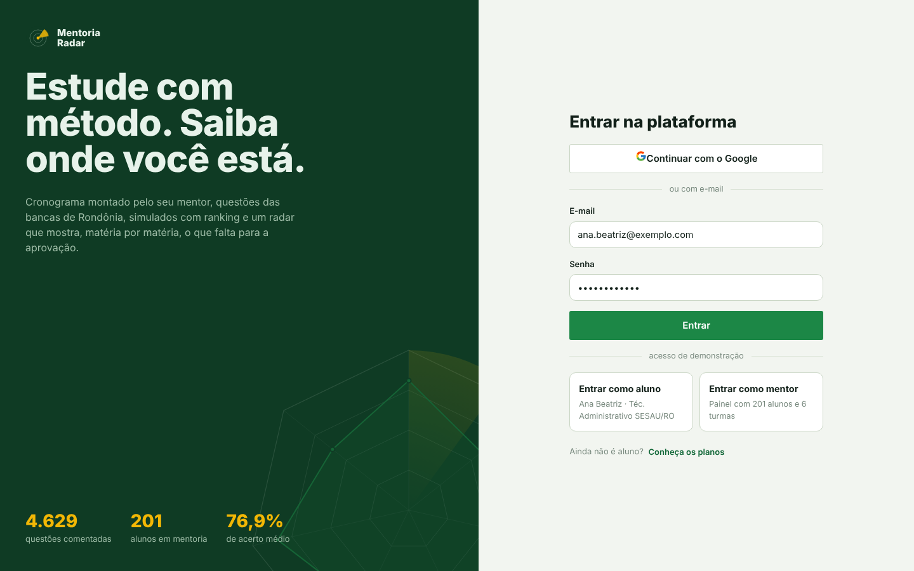 | 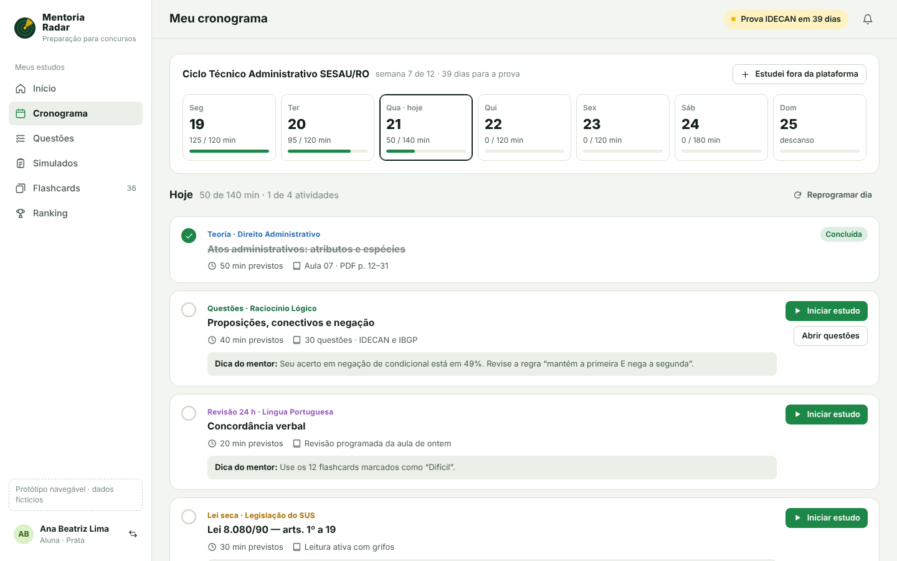 |
| 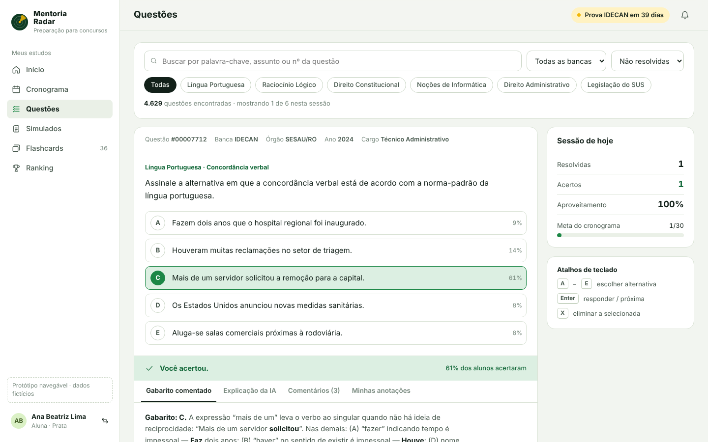 | 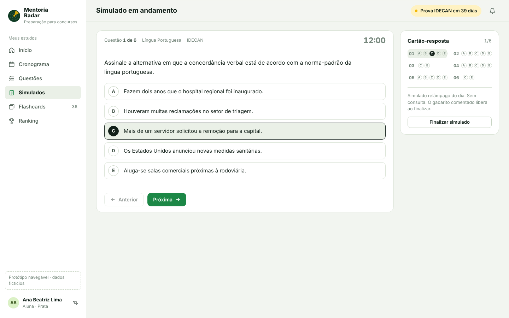 |
| 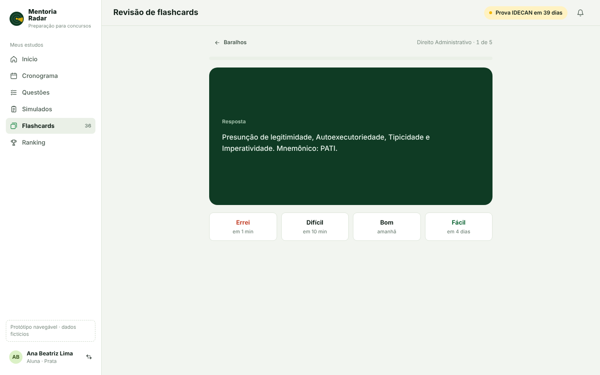 | 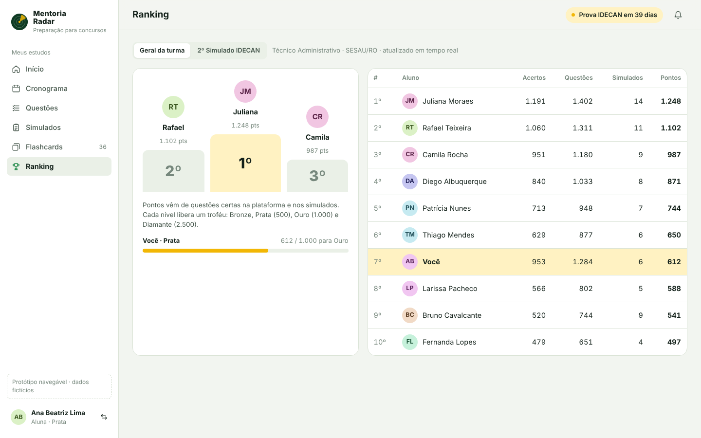 |
| 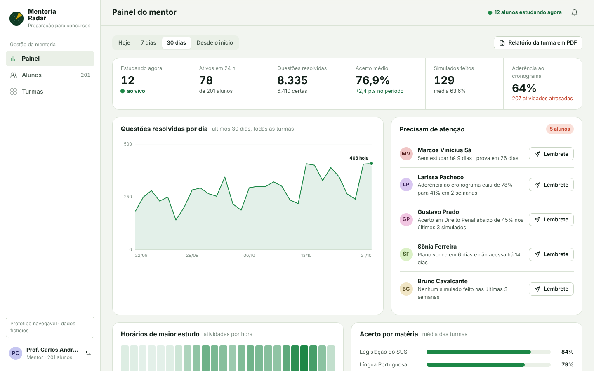 | 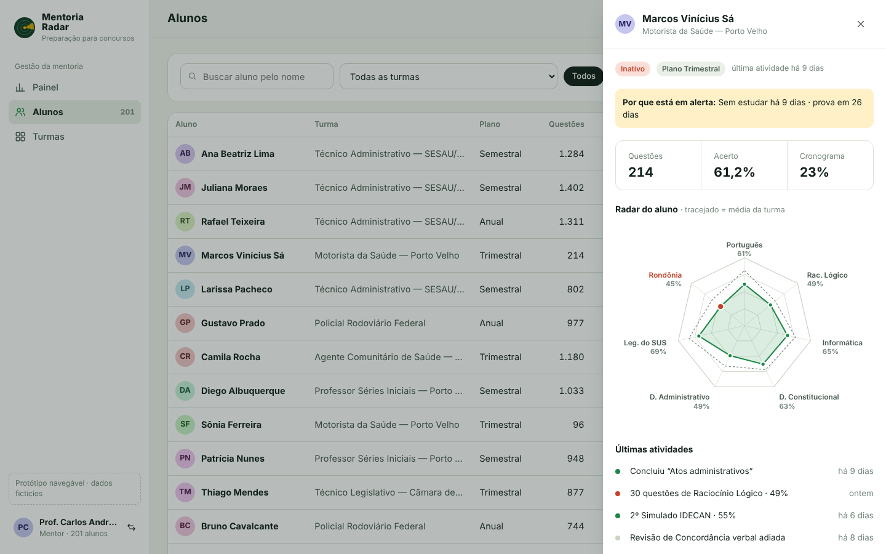 |
| 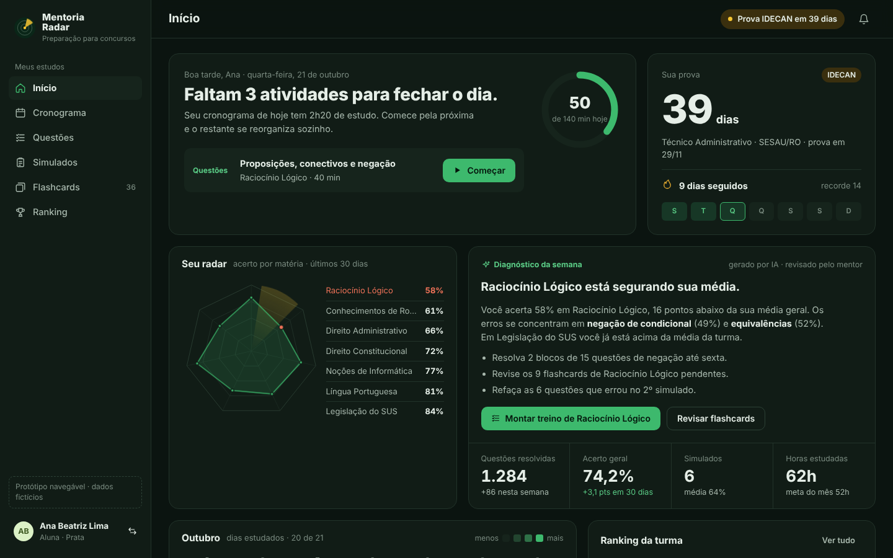 | 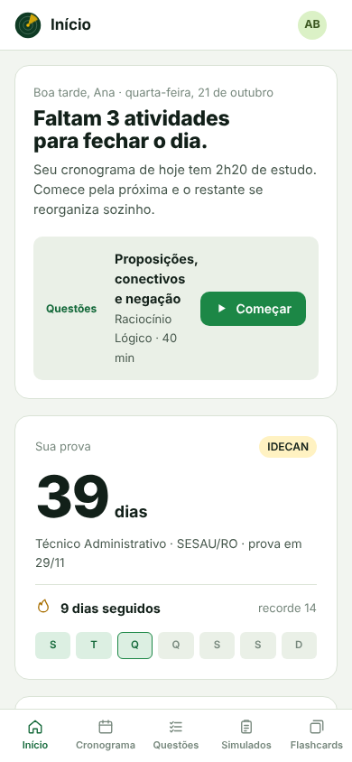 |

## Próximos passos para implementação

A plataforma atual é feita no Base44, com React, Tailwind e componentes shadcn/ui. Por isso, este protótipo pode ser levado ao app real em etapas:

1. Traduzir os tokens de cor e tipografia deste protótipo para o tema do Tailwind do projeto.
2. Aplicar o novo shell (navegação lateral e barra inferior no telemóvel) e a home do aluno com o radar.
3. Redesenhar a plataforma de questões e o fluxo de simulados.
4. Montar o painel do mentor com os alertas de alunos em risco.

---

Proposta desenvolvida por [Funny Terrace](https://funnyterrace.com).
